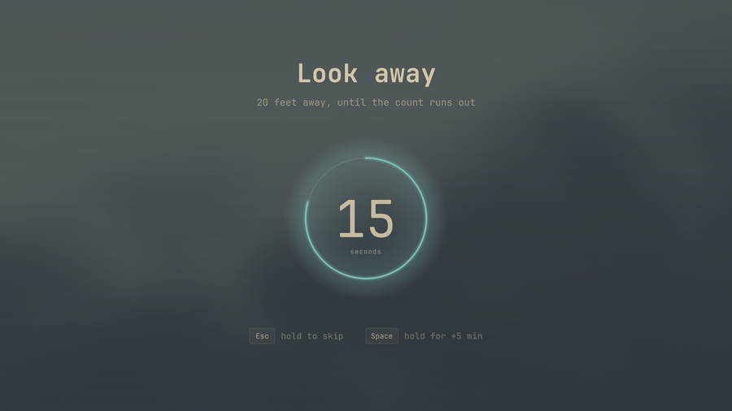
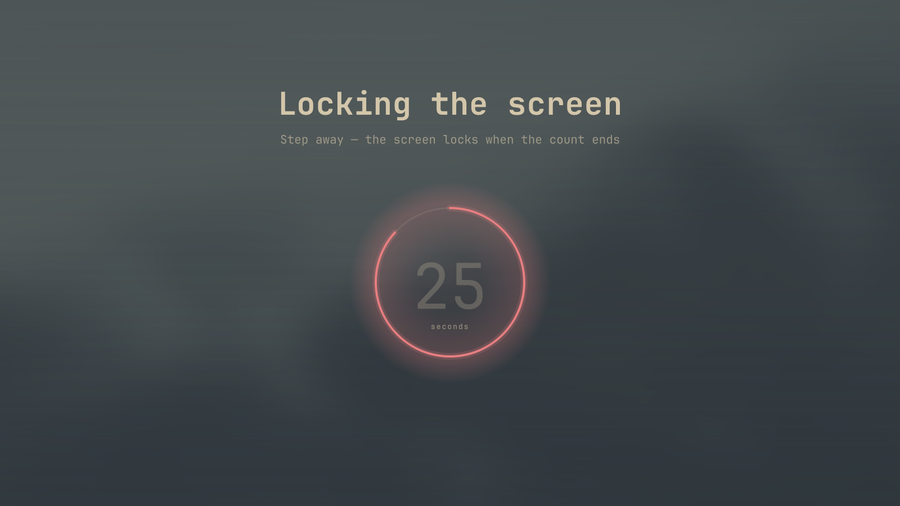

# Omablink

A screen-break timer for the [Omarchy](https://omarchy.org) bar. It reminds
you to look away from the screen, to stand up, and to blink, and it waits
while you are on a call.



## Quick start

```bash
omarchy plugin add https://github.com/vyacheslav-voloshyn/omablink.git --enable
```

A countdown to the next break appears in the bar: 

- **Click** it for today's numbers and all the settings.
- **Right-click** it to take an eye break now.
- **Middle-click** it to pause or resume.

The defaults follow the 20-20-20 rule, so you don't need to configure anything.
Requires Omarchy 4 and is tested on 4.5.

## What happens and when

| Reminder | Default | What you see | Can you skip it? |
|---|---|---|---|
| Eye break | every 20 min, for 20 s | Full screen: the blurred wallpaper and a countdown ring | Yes |
| Long break | every 4 h, for 2 min | The same screen, telling you to stand up | Yes |
| Screen lock | every 45 min | A 30 s countdown, then Omarchy's lock screen | **No** |
| Blink hint | every 5 min, for 2 s | A small card in the top-right corner whose eye blinks twice | It goes away on its own |

A minute before a break, a notification tells you it is coming.

The reminders run on separate timers. Skipping one does not move the others.
A longer rest counts for the shorter ones: a long break resets the eye timer,
and a lock resets everything.


### During a break

| To | Do this |
|---|---|
| Skip the break | Hold `Esc`, or click *hold to skip* |
| Postpone it by 5 min | Hold `Space`, or click *hold for +5 min* |

You have to hold the key, not tap it. `Esc` is too common a keystroke,
especially in vim: a single press closed the break before it had finished
drawing. A lock break ignores both keys.



## Settings

Click the widget. Everything is in that one panel:

- **Today**: breaks taken, skipped, blink hints, and screen time.
- **Schedule**: change intervals and lengths with − / +.
- **Breaks and holds**: turn each reminder and each hold condition on or off.
- **Buttons** to start an eye break, start a long break, or pause.


The panel writes to the widget's entry in `~/.config/omarchy/shell.json`.
That file is the only place settings are stored, and a hand edit takes effect
immediately.

| Key | Default | Meaning |
|---|---|---|
| `workMinutes` | 20 | Time between eye breaks |
| `breakSeconds` | 20 | Length of an eye break |
| `longEnabled` | true | Long breaks on |
| `longMinutes` / `longSeconds` | 240 / 120 | Time between long breaks / their length |
| `lockEnabled` | true | Screen lock on |
| `lockMinutes` | 45 | Time between screen locks |
| `lockCountdownSeconds` | 30 | Countdown before the screen locks |
| `blinkEnabled` | true | Blink hints on |
| `blinkMinutes` / `blinkHintSeconds` | 5 / 2 | Time between blink hints / how long the card stays |
| `headsUpSeconds` | 60 | How early the "break soon" notification comes (0 turns it off) |
| `postponeMinutes` | 5 | How much one postpone adds |
| `idleMinutes` | 3 | How long you must be away before the timers stop |
| `pauseOnFullscreen` | true | Wait while a window is fullscreen |
| `pauseOnMicrophone` | true | Wait while an app is using the microphone |
| `pauseOnVideo` | true | Wait while the camera or a screen share is on |
| `pauseOnMeeting` | true | Wait while a window matching `meetingPattern` is open |
| `meetingPattern` | Meet, Zoom, Teams, Webex, Jitsi, huddle | Regex checked against every window's title and class |
| `pauseOnIdle` | true | Stop the timers while you are away |

The − / + buttons move in steps: 5 min for the eye break, 15 min for the long
break. To set a value between steps, use `set` (see below) or edit
`shell.json` directly.

Omarchy has a built-in settings form for bar widgets, but it is never
displayed, which is why the panel handles settings itself.

## Breaks wait for your calls

If a break comes due at a bad moment, it is not dropped. It moves back a
minute at a time until the moment passes. The widget's tooltip shows what it
is waiting for.

What counts as a bad moment:

- **Microphone in use.** This catches calls in a browser tab, such as Google
  Meet or a Slack huddle. Muting releases the microphone, so a muted call is
  caught only by the meeting window check below.
- **A meeting window**, found by `meetingPattern`. This also catches a call
  where you only listen. Keep the pattern narrow: one that matches a chat app
  you keep open all day would hold every break forever. A browser only reports
  the title of its active tab, so a call in a background tab is not seen.
- **Camera or screen share**, found through PipeWire video nodes.
- **A fullscreen window.**
- **You are away.** After `idleMinutes` with no input, the timers stop. If
  you were away longer than one break, the break counts as taken. A video
  player that keeps the screen awake does not stop the eye timer.

These checks are made by `bin/omablink-pause-check`. It runs once, at the
moment a break is due, not in the background. It takes about 40 ms.

## Keybindings and scripting

Omablink adds no keybindings. To add your own, put them in
`~/.config/hypr/bindings.lua`:

```lua
o.bind("SUPER + ALT + L", "Omablink settings", "omarchy-shell amsi.omablink panel")
o.bind("SUPER + SHIFT + L", "Omablink pause", "omarchy-shell amsi.omablink toggle")
o.bind("SUPER + SHIFT + CTRL + L", "Omablink break now", "omarchy-shell amsi.omablink breakNow")
```

Every action can also be run from the command line, with
`omarchy-shell amsi.omablink <command>`:

| Command | What it does |
|---|---|
| `status` | Shows the next break and the settings in effect |
| `stats` | Prints today's numbers as JSON |
| `panel` | Opens or closes the panel |
| `pause` / `resume` / `toggle` | Pauses or resumes the timers |
| `breakNow` / `longNow` / `lockNow` | Starts that break now |
| `skip` | Skips the running break (not a lock) |
| `blink` | Shows the blink hint |
| `set <key> <value>` | Changes a setting, the same way the panel does |

`set` is useful from a hook, for example `set lockEnabled false` while
presenting, or `set workMinutes 25`.

## Statistics

Daily totals are stored in `~/.local/state/omarchy/omablink.json`, one row
per day for the last 30 days: breaks per type, locks, skipped, postponed,
deferred, blink hints, and screen time. Screen time counts only the seconds
the timer was running, so time paused or away is left out.

## Troubleshooting

**Breaks come more often than you set.** Run `omarchy-shell amsi.omablink status`.
It shows the settings the widget is actually using, which can differ from
what you expect.

**The panel or a break looks wrong after editing the plugin's code.** Run
`omarchy restart shell`. A plain reload can leave the old copy of the widget
running.

**The screen locks but will not accept your password.** Omablink switches the
keyboard to the first layout in `kb_layout` before it locks, so the password
is never typed in a layout like Cyrillic. The lock is Omarchy's own
(`omarchy-shell lock lock`), and its password prompt needs PAM: check
`omarchy-shell lock status` for `passwordPam`.

**Breaks never come.** Look at the widget's tooltip. If it says *Waiting:
meeting window open* and you are not in a meeting, `meetingPattern` is
matching something that is always open.

**The break screen has no wallpaper.** The blur needs an image wallpaper. A
video wallpaper falls back to the theme's plain background.

## Development

```bash
node test/model-test.cjs   # timer, stepper and statistics logic; runs without Qt
```

The timer and statistics logic lives in `Model.js`, which needs no Qt. The
`.qml` files handle windows, timers and the hold checks. After changing code,
copy the files into `~/.config/omarchy/plugins/amsi.omablink/` and run
`omarchy restart shell`.

## Support

If this saves your eyes, [sponsor the project](https://github.com/sponsors/vyacheslav-voloshyn).

## License

MIT
