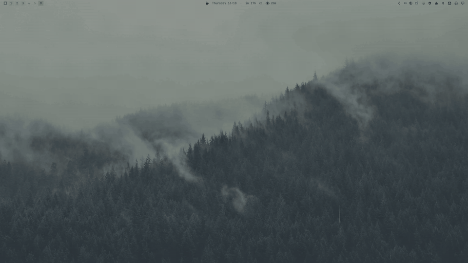
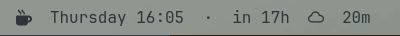
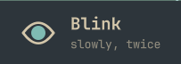
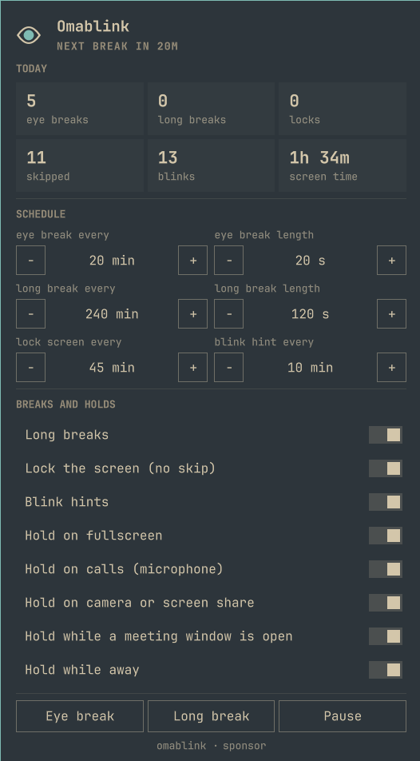

# Omablink

A screen-break timer for the [Omarchy](https://omarchy.org) bar: look away,
stand up, blink — and it waits while you are on a call.



## Install

```bash
omarchy plugin add https://github.com/vyacheslav-voloshyn/omablink.git --enable
```

A countdown appears in the bar . **Click** it for
stats and settings, **right-click** for a break now, **middle-click** to pause.
Tested on Omarchy 4.5. Nothing to install beyond Omarchy itself: it uses
`hyprctl`, `pw-dump`, `pactl` and `notify-send`, which Omarchy ships.

To remove it: `omarchy plugin remove amsi.omablink`, then `omarchy restart shell`.
Its settings live only in the widget's entry in `~/.config/omarchy/shell.json`,
and its daily stats in `~/.local/state/omarchy/omablink.json`.

## Reminders

| Reminder | Default | Skip |
|---|---|---|
| Eye break, fullscreen | every 20 min, 20 s | hold `Esc` |
| Long break, "stand up" | every 4 h, 2 min | hold `Esc` |
| Screen lock, after a countdown | every 45 min | no |
| Blink hint, a corner card  | every 5 min | goes by itself |

During a break your screen drifts out of focus into fog that breathes on a
six-second cycle, with a tip on what to do; when it ends, the fog clears and
the screen comes back sharp. A lock break darkens instead, like dusk.

Hold `Space` to postpone a break by 5 min. A notification comes a minute
before each break. A longer break resets the shorter timers.

## Settings

Everything is in the panel. It writes to the widget's entry in
`~/.config/omarchy/shell.json`, which you can also edit by hand.



<details>
<summary>All keys</summary>

| Key | Default | Meaning |
|---|---|---|
| `workMinutes` / `breakSeconds` | 20 / 20 | Eye break interval / length |
| `longEnabled`, `longMinutes` / `longSeconds` | true, 240 / 120 | Long break |
| `lockEnabled`, `lockMinutes`, `lockCountdownSeconds` | true, 45, 30 | Screen lock |
| `blinkEnabled`, `blinkMinutes` / `blinkHintSeconds` | true, 5 / 2 | Blink hint |
| `barIcon`, `barIconAnimated` | true, true | Eye beside the countdown; it blinks with each hint and every 10 s in the last minute |
| `headsUpSeconds` | 60 | Notice before a break, 0 = off |
| `postponeMinutes` | 5 | What a postpone adds |
| `idleMinutes` | 3 | Away time that stops the timers |
| `pauseOnFullscreen`, `pauseOnMicrophone`, `pauseOnVideo`, `pauseOnMeeting`, `pauseOnIdle` | true | Hold conditions, see below |
| `meetingPattern` | Meet, Zoom, Teams, Webex, Jitsi, huddle | Regex over window titles and classes |

</details>

## Holds

A break that comes due at a bad moment waits a minute at a time instead of
being dropped. It waits while the microphone, the camera or a screen share is
in use, while a meeting window is open, during fullscreen, and while you are
away. Being away longer than a break counts as the break. The tooltip shows
what it is waiting for.

## Command line

```
omarchy-shell amsi.omablink status | stats | panel
omarchy-shell amsi.omablink pause | resume | toggle | skip | blink
omarchy-shell amsi.omablink breakNow | longNow | lockNow
omarchy-shell amsi.omablink set <key> <value>     # e.g. set workMinutes 25
```

Bind any of them in `~/.config/hypr/bindings.lua`.

## Troubleshooting

- **Breaks feel too frequent:** `status` shows the settings actually in use.
- **Breaks never come:** the tooltip says what holds them; a too-broad
  `meetingPattern` holds them forever.
- **Lock rejects the password:** the lock screen needs PAM; check
  `omarchy-shell lock status`.
- **Code changes don't apply:** run `omarchy restart shell`.

Statistics for the last 30 days are kept in `~/.local/state/omarchy/omablink.json`.
Tests: `node test/model-test.cjs`.

[Sponsor](https://github.com/sponsors/vyacheslav-voloshyn) · MIT
